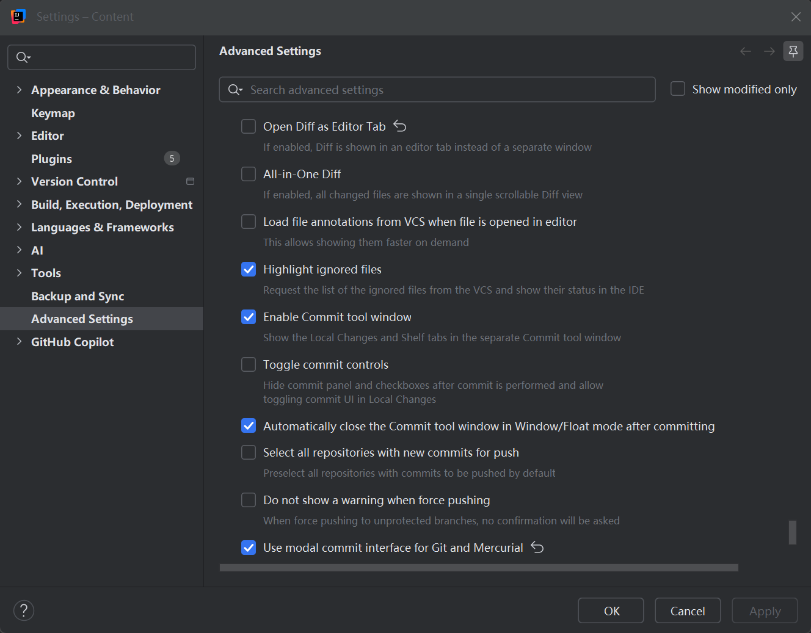

IntelliJ IDEA的Diff视图（包括跨文件内容对比、git文件变更、git文件历史等）现在默认是通过编辑器标签页打开，如果更习惯使用独立弹窗查看代码差异，可以通过以下设置进行修改。

## 修改设置步骤

1. 打开`Settings`；
2. 进入`Advanced Settings`（如果正在连接远程服务器开发，则进入`Advanced Settings Host`），找到`Version Control`分组（不是`Version Control.Git`，注意区分）；
3. 取消勾选`Open Diff as Editor Tab`，保存设置后即可通过独立窗口查看diff；
4. 另外Commit窗口现在默认在工具窗口打开，同样在上面的位置，找到`Version Control`分组下的`Use modal commit interface for Git and Mercurial`，勾选上即可改为通过模态窗口打开Commit窗口；

> 参考：[JetBrains官方文档：配置Diff视图的打开方式](https://www.jetbrains.com/help/idea/commit-and-push-changes.html#diff-viewer)
